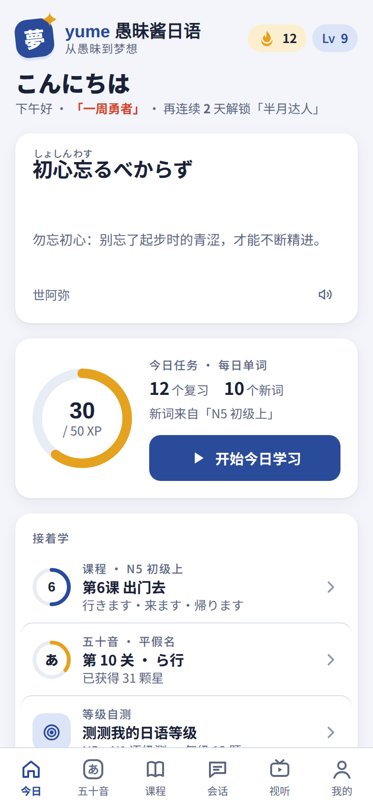
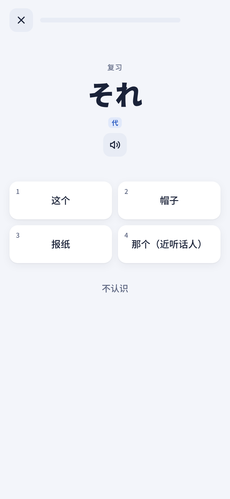
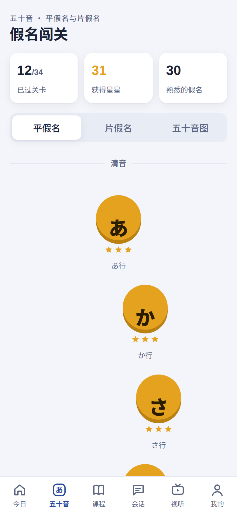
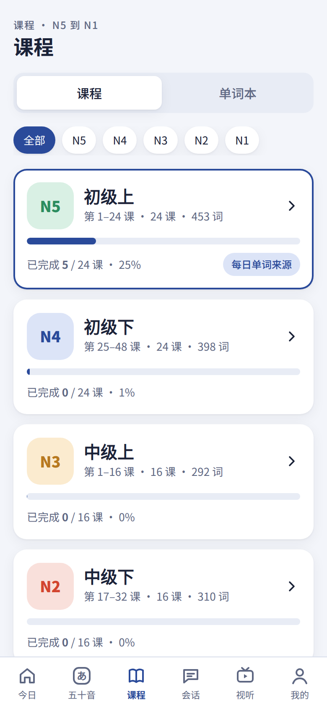
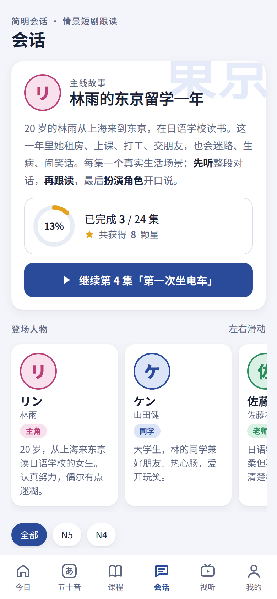

<div align="center">


# yume 愚昧酱日语

**从愚昧到梦想**：一个免费、开源、打开就能用的日语学习网站

[在线体验](https://yume-nihongo.netlify.app) · [本地运行](#本地运行) · [部署](#部署) · [开发文档](API.md)

</div>

<p align="center">
  
  
  
  
  
</p>

yume（夢）是为中文母语者做的日语学习网站：从五十音开始，跟着 104 课一路学到 N1。没有广告，不用注册，学习进度只保存在你自己的设备上。手机、平板、电脑的浏览器都能用，也可以添加到桌面，像 App 一样打开。

> **English:** yume is a free, open-source Japanese learning web app for Chinese speakers. It has kana games, 104 lessons from JLPT N5 to N1, a dialogue drama series, shadowing with speech recognition, and a placement test. It is a static PWA with no backend, and your progress stays on your device.

## 功能

| | |
|---|---|
| **五十音闯关** | 平假名、片假名各 17 关，有红心、星级和连击；五十音图可以点着听 |
| **课程 N5 → N1** | 6 册 104 课：2391 个单词、755 个语法点、1132 道练习 |
| **每日单词** | 每天自动安排「到期复习 + 新词」，按间隔重复记忆；题型有看日语选意思、看中文选日语、听发音选意思 |
| **简明会话** | 原创情景短剧「林雨的东京留学一年」，24 集（N5–N4）：先听，再跟读，最后扮演角色开口说 |
| **跟读评分** | 用浏览器自带的语音识别检查你读得对不对（Chrome、Edge、安卓 Chrome 等支持） |
| **视听** | 贴 YouTube / B 站链接，导入字幕后逐句跟读；可以让 AI 讲解句子（DeepSeek / 通义千问，自备 API Key） |
| **等级自测** | N5–N1 共 120 题，测出该从哪一课开始学 |
| **学习激励** | XP 与等级、连续打卡、称号（3 天到 365 天）、徽章；首页每日一言（俳句、谚语，日中对照） |
| **发音** | 优先用设备自带的日语语音，没有时自动改用在线发音；可以调语速 |
| **多设备同步** | 不用注册：开启后得到一串同步码，在另一台设备上输入就行；两边学的都保留，之后自动同步 |
| **离线可用** | 第二次打开起从本机加载，网络不好也能打开；可以添加到桌面 |

## 进度保存在哪里

- 不用注册。进度默认只保存在浏览器本地（localStorage），每天还会在 IndexedDB 里自动备份一份（保留 7 天）；本机进度被清掉时，打开网站会自动从备份找回。
- 开启「多设备同步」后，进度会另外保存一份在网站服务器上（Netlify Blobs），只有知道同步码的人能读取；AI Key、字幕和视听库不会上传。服务器只存同步码的哈希值，不存同步码本身。在「我的 → 多设备同步」里可以随时删除云端数据。
- 同时开着好几个页面也不会互相覆盖，保存前会自动合并。
- 换设备：在「我的 → 存档与备份」导出存档文件，或者复制存档文字，到新设备上恢复（可以选「合并」或「覆盖」）。
- AI 讲解用的 API Key 只保存在本机，请求直接发给你选的服务商。
- 在线发音会把要朗读的日文发给有道 / 百度的朗读接口。

## 本地运行

只需要 Python 3（只用到标准库）：

```bash
git clone https://github.com/mikechengx/yume-nihongo.git
cd yume-nihongo
python3 build.py
python3 -m http.server 8080 -d dist/yume-site
```

然后在浏览器打开 <http://localhost:8080>。

想在本地试「多设备同步」，要用自带的开发服务器（需要 Node.js 18+，同步数据只存在内存里）：

```bash
python3 build.py
node tools/devserver.mjs        # 打开 http://localhost:8790
```

用 `http://localhost:8790` 和 `http://127.0.0.1:8790` 分别打开，就相当于两台设备（两边的本机存储是分开的）。

## 部署

`python3 build.py` 生成的 `dist/yume-site/` 是一个纯静态网站，放到任何静态托管服务上都能用：

- **Netlify（推荐）**：在 Netlify 上连接这个仓库，推送代码后会自动构建、部署。`netlify.toml` 里已经写好构建命令，也会一起部署「多设备同步」的后台程序（`netlify/functions/sync.mjs`，数据存在 Netlify Blobs，免费额度够个人和朋友用）。
- 只想要网页的话，把 `dist/yume-site` 文件夹拖进 Netlify，或者放到 **GitHub Pages、Cloudflare Pages、腾讯云 EdgeOne Pages** 等任何静态托管上都行。只是没有后台，「多设备同步」用不了，卡片里会说明；其他功能都正常。需要在国内访问的话，推荐 EdgeOne Pages。
- `_headers` 是 Netlify / Cloudflare Pages 的缓存规则：带版本号的 js、css 和课程数据长期缓存，首页和 `sw.js` 每次都检查更新。

## 目录结构

```
├── page.html          页面骨架（build.py 用它生成 index.html）
├── css/app.css        样式（含暗色模式）
├── js/
│   ├── core.js        核心：存档（多页面合并、自动备份、恢复）、发音、复习规则、渲染框架
│   ├── home.js        今日
│   ├── kana.js        五十音闯关
│   ├── course.js      课程、单词本、练习
│   ├── easy.js        简明会话
│   ├── speech.js      跟读评分
│   ├── media.js       视听
│   ├── ai.js          AI 讲解
│   ├── test.js        等级自测
│   ├── me.js          我的（设置、存档与备份）
│   ├── pwa.js         离线缓存、添加到桌面
│   ├── sync.js        多设备同步（同步码）
│   └── boot.js        启动
├── content/           课程数据（网页直接加载；除 quotes.js 外都由 tools/assemble.py 生成）
│   └── parts/         课程原始数据（JSON），改内容就改这里
├── netlify/           同步码后台：functions/sync.mjs（Netlify 入口）、sync-core.mjs（逻辑，本地开发和测试也用它）
├── pwa/               离线缓存程序模板、manifest、_headers
├── icons/             图标（tools/make_icons.py 生成）
├── tools/             组装课程数据、测试脚本、本地开发服务器（devserver.mjs）
├── docs/screenshots/  截图
├── build.py           构建脚本
└── API.md             开发文档：模块接口、存档结构、合并规则
```

## 修改课程内容

1. 编辑 `content/parts/` 里的 JSON（每个文件是几课的内容）。
2. 运行 `python3 tools/assemble.py`。它会先检查格式（比如汉字后面缺读音、单词少了中文释义），再重新生成 `content/*.js`。
3. 运行 `python3 build.py` 重新构建。

## 测试

需要 Node.js 18 或更新的版本：

```bash
node tools/smoke.js            # 冒烟测试：加载全部模块，逐个打开各个页面
node tools/datasafe.test.js    # 防丢数据：多个页面同时保存、存档损坏、合并、撤销、恢复
node tools/tts.test.js         # 发音：设备语音和在线发音之间的切换
node tools/sync.test.mjs       # 多设备同步：开启、加入、两边同时学、写入冲突、断网、清空、删除
```

也可以用 `npm test` 一次跑完。

## 声明

- 课程顺序参考了《新版中日交流标准日本语》（初级上 → 高级下），方便用这套教材的同学对照着学。讲解、例句、对话和练习都是本项目自己编写的，不包含教材原文、插图或录音；本项目与教材的编者、出版社没有任何关系。
- 首页「一言」里的俳句都是已经进入公有领域的作品，其余是谚语、常用说法和原创短句。
- 在线发音用的是有道词典、百度翻译网页上公开的朗读接口，只用于学习；「视听」里的视频都是外部链接，版权归原作者。

## 许可

[MIT](LICENSE)
